<!-- ═══════════════════════════ HEADER ═══════════════════════════ -->

  

  

  
  
  
  

  

  

<!-- ═══════════════════════════ ABOUT ═══════════════════════════ -->
## About Me

  

<!-- ═══════════════════════════ IMPACT ═══════════════════════════ -->
## Impact Dashboard

  

<!-- ═══════════════════════════ PIPELINE ═══════════════════════════ -->
## How I Work

  

<!-- ═══════════════════════════ EXPERTISE ═══════════════════════════ -->
## Core Expertise

  

 

Click a skill to see the repos that use it

  
  
  
  
   
  
  
  

<!-- ═══════════════════════════ PROJECTS ═══════════════════════════ -->
## Featured Projects

| Project | What it does | Stack |
|---|---|---|
| **[AI Reporting Agent on BigQuery](https://github.com/Ahadmoen/ai-reporting-agent-bigquery)** | Gemini agent over a reconciled BigQuery layer. **168/168 audited periods matched**; sales reports in 6–20 s | Vertex AI ADK · BigQuery · Cloud Run · FastAPI · n8n |
| **[Shopify Retail Analytics](https://github.com/Ahadmoen/Shopify-Detailed-Pipeline-and-Analytics)** | 7 daily pipelines for 5 stores, 9 deduplicated views, 8 dashboards. **Revenue within 0.3%** | Python · n8n · BigQuery · Metabase |
| **[Brand Reputation Monitoring](https://github.com/Ahadmoen/brand-reputation-monitoring-dashboard)** | Social listening dashboard: daily KPIs, sentiment and risk, follow-up queue | Looker Studio · BigQuery |
| **[Automated Ads Analytics](https://github.com/Ahadmoen/Automated-Ads-Analytics)** | Fault-tolerant pipeline with Spark fallback, Looker dashboards and Slack alerts | Spark · BigQuery · Looker · Slack |
| **[Production Airflow Pipeline](https://github.com/Ahadmoen/production-airflow-sales-pipeline)** | Daily sales DAG with retries, SLA monitoring and dependencies | Airflow · Python |
| **[FinMate](https://github.com/Ahadmoen/FInMate)** | Stock intelligence: LSTM/ARIMA forecasts, FinBERT sentiment, RAG chatbot | Gemini · Django · React Native |
| **[Medicine Forecasting](https://github.com/Ahadmoen/Medicine_Forecasting)** | Time-series demand forecasting for medicines | Python · scikit-learn |

<b>More ETL pipelines (click to expand)</b>

 

| Pipeline | Route |
|---|---|
| [Amazon ETL](https://github.com/Ahadmoen/Amazon_ETL_Pipeline_BQ) | Amazon → BigQuery |
| [Checkout Champ ETL](https://github.com/Ahadmoen/Checkout-Champ-Pipeline-ETL) | Checkout Champ → BigQuery |
| [GoHighLevel ETL](https://github.com/Ahadmoen/GHL-ETL-Pipeline-Dashboard) | GHL → warehouse → dashboard |
| [Flowspace Orders Audit](https://github.com/Ahadmoen/Flowspace_Orders_Audit_ETL_Pipelines) | Orders → audit checks |
| [NewsBreak ETL](https://github.com/Ahadmoen/NewsBreak_ETL_Pipeline) | NewsBreak → warehouse |
| [Shopify ETL (Spark)](https://github.com/Ahadmoen/Shopify_ETL_Apache_Spark) | Shopify REST → Parquet → BigQuery |

<b>Full case studies on my <a href="https://ahadmoeen.netlify.app/projects">portfolio website</a></b>

<!-- ═══════════════════════════ STACK ═══════════════════════════ -->
## Tech Stack

<table align="center">
  <tr>
    <td width="220"><b>Data Engineering</b></td>
    <td width="980">
      
      
      
      
      
      
      
      
      
      
    </td>
  </tr>
  <tr>
    <td><b>Analytics & BI</b></td>
    <td>
      
      
      
      
      
      
    </td>
  </tr>
  <tr>
    <td><b>ML & AI</b></td>
    <td>
      
      
      
      
      
      
      
      
      
      
    </td>
  </tr>
  <tr>
    <td><b>Visualisation</b></td>
    <td>
      
      
      
    </td>
  </tr>
</table>

<!-- ═══════════════════════════ CERTS ═══════════════════════════ -->
## Certifications

<table align="center">
  <tr><th align="left" width="600">Certificate</th><th align="left" width="400">Issuer</th><th align="center" width="200">Credential</th></tr>
  <tr><td>Data Engineering Professional Certificate</td><td>DeepLearning.AI & AWS · 2026</td><td align="center"></td></tr>
  <tr><td>Associate Data Scientist</td><td>DataCamp</td><td align="center"></td></tr>
  <tr><td>Associate AI/ML for Data Scientists</td><td>DataCamp</td><td align="center"></td></tr>
  <tr><td>Career Essentials in Data Analysis</td><td>Microsoft & LinkedIn</td><td align="center"></td></tr>
  <tr><td>Data Analysis with Python</td><td>freeCodeCamp</td><td align="center"></td></tr>
</table>

<!-- ═══════════════════════════ STATS ═══════════════════════════ -->
## GitHub Telemetry

  

<table align="center">
  <tr>
    <td width="600" align="center">
      
    </td>
    <td width="600" align="center">
      
    </td>
  </tr>
  <tr>
    <td colspan="2" align="center"><b>Open-source data pipelines</b></td>
  </tr>
  <tr>
    <td align="center">
      
    </td>
    <td align="center">
      
    </td>
  </tr>
  <tr>
    <td align="center">
      
    </td>
    <td align="center">
      
    </td>
  </tr>
  <tr>
    <td colspan="2" align="center">
      
    </td>
  </tr>
</table>

<!-- Animated contribution snake: generated daily by .github/workflows/snake.yml into the "output" branch -->

  <picture>
    <source media="(prefers-color-scheme: dark)" srcset="https://raw.githubusercontent.com/Ahadmoen/Ahadmoen/output/github-snake-dark.svg" />
    
  </picture>

<!-- ═══════════════════════════ CONNECT ═══════════════════════════ -->
## Let's Connect

  

   
  — commonly attributed to W. Edwards Deming

  

